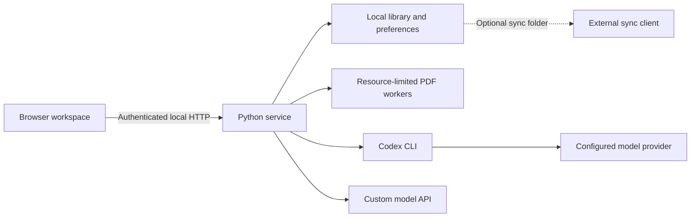

# Architecture

PaperDesk consists of a local Python HTTP service and a browser interface. The frontend uses HTML, CSS, and JavaScript without a build step. Source setup uses Node.js/npm to install the official Codex CLI; model requests execute its native binary. The Windows desktop edition bundles Electron, a frozen Python backend, and that native CLI without requiring external Python or Node.js. The Python package name remains `easyread` for compatibility.

## Components

| Module | Responsibility |
|---|---|
| `easyread/server.py`, `library_api.py` | Local HTTP endpoints, authentication, and library operations |
| `easyread/library.py`, `store.py` | Document storage, annotations, and operation merging |
| `easyread/engines.py`, `chat.py` | Model requests, streaming, usage reporting, and cancellation |
| `easyread/account_usage.py`, `usage.py`, `budget.py` | Account quotas and local usage limits |
| `easyread/pdf_isolation.py`, `pdfwork.py`, `epub.py` | Isolated PDF/EPUB processing, resource limits, and page images |
| `electron/` | Desktop window, trusted IPC, official CLI login, and authenticated document windows |
| `easyread/cloudlib*.py` | Library copy, switch, merge, and rollback |
| `easyread/web/` | Library, reading workspace, and shared settings |

## Design decisions

- The current distribution targets Windows x64 and runs from source.
- Documents and preferences are stored locally. Cloud synchronization is handled by a user-selected sync client.
- The Codex CLI manages model authentication and retains its configured provider and proxy settings.
- PDF workers have resource limits; model processes restrict unnecessary tools. Both run under the current operating-system user.
- Changes to storage and shared reading flows must preserve existing data and cover cancellation, recovery, and compatibility.

See [data flows](CONNECTIONS.md), [validation](docs/VALIDATION.md), and [release scope](docs/RELEASE.md).
