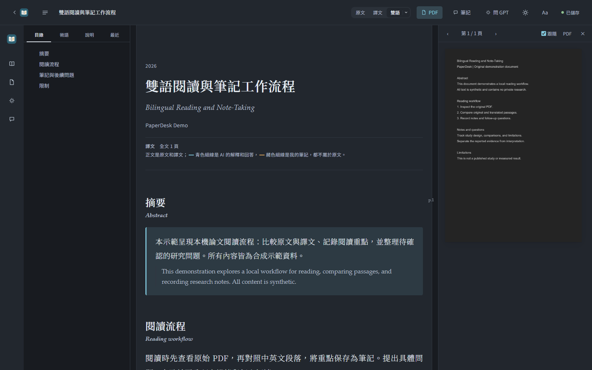
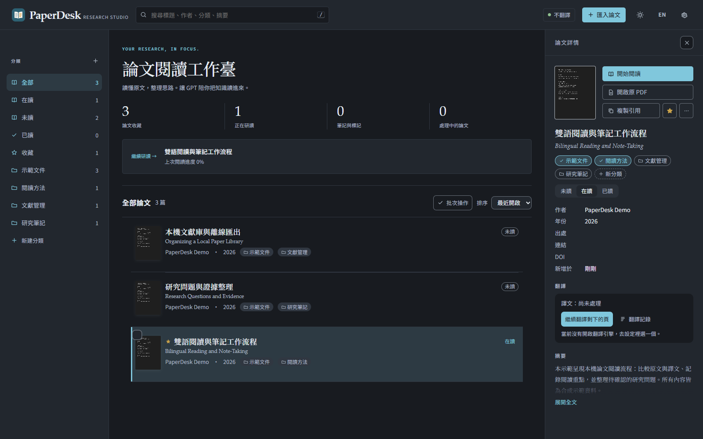
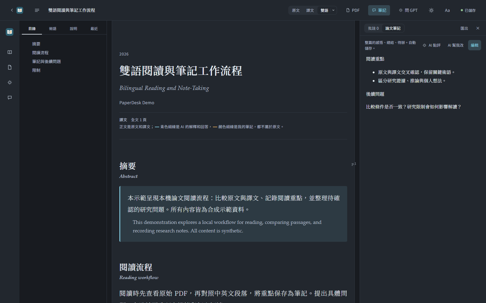
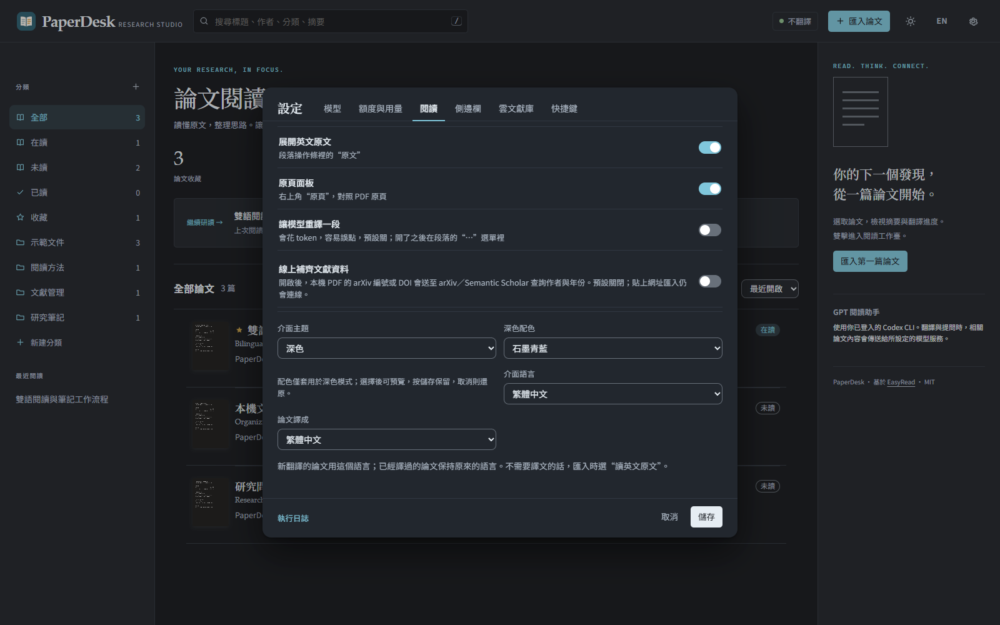

# PaperDesk

**繁體中文** | [English](README.en.md)


繁體中文論文閱讀工作台，整合 PDF 原文對照、翻譯、GPT 問答、筆記與文獻庫管理。

PaperDesk 在本機執行，以瀏覽器開啟閱讀介面，預設透過官方 Codex CLI 連線模型。目前提供 Windows x64 原始碼版。

[快速開始](#快速開始) · [使用指南](docs/USAGE.md) · [架構](ARCHITECTURE.md) · [參與開發](CONTRIBUTING.md)

## 功能

- **文獻庫管理**：匯入本機 PDF 或公開論文網址，搜尋、分類、查看詳情及回收站還原。
- **雙語閱讀**：切換原文、譯文與雙語模式，透過目錄、術語及 PDF 面板對照原頁。
- **GPT 閱讀助手**：使用相關段落與選用頁圖進行翻譯、提問及筆記輔助。
- **筆記與匯出**：文字批註、論文筆記、自動保存，以及 Markdown 與單一 HTML 離線匯出。
- **模型與用量設定**：Codex CLI、Claude Code、本機模型服務及自訂 API；官方帳號額度查詢與本機每日使用門檻。
- **閱讀偏好**：繁體中文／英文介面、字型、字級、行距、快捷鍵及五組深色配色。

## 介面預覽

以下截圖使用合成示範文件與筆記。

### 論文閱讀工作台

雙語段落、論文目錄與 PDF 原頁對照。



<details>
<summary>文獻庫、筆記與閱讀設定</summary>

### 文獻庫



### 論文筆記



### 閱讀設定



</details>

## 快速開始

### 環境需求

| 項目 | 需求 |
|---|---|
| 作業系統 | Windows x64 |
| Python | 64 位元 3.10–3.13，建議 3.12 |
| Node.js | 20 以上，包含 npm，建議 24 |
| 模型帳號 | 使用翻譯與問答時，需要有效的 Codex CLI 登入或其他模型服務設定 |

### 安裝

Clone 此 repository，或從 GitHub 的 **Code → Download ZIP** 下載並解壓。開啟專案資料夾，在 PowerShell 執行：

```powershell
.\Setup-PaperDesk.cmd
```

也可以雙擊 `Setup-PaperDesk.cmd`。安裝器會建立專案內的 Python 環境與官方 Codex CLI，使用固定版本及完整性驗證安裝依賴。

### 登入 Codex

```powershell
node .tools/codex/node_modules/@openai/codex/bin/codex.js login
node .tools/codex/node_modules/@openai/codex/bin/codex.js login status
```

已有有效 CLI 登入時可直接沿用。單純閱讀本機 PDF 與寫筆記不需要模型登入。

> 以 ChatGPT 帳號登入 Codex CLI 時，翻譯與問答使用 Codex／代理工作額度。API 金鑰模式依 API 帳戶計費。ChatGPT 網頁登入與 CLI 登入是不同的流程。

### 啟動

```powershell
.\Open-PaperDesk.cmd
```

啟動器會開啟本機服務與瀏覽器。預設網址為 `http://127.0.0.1:8876`；連線埠被使用時，以啟動器開啟的網址為準。後續開啟也使用同一個啟動器。

## 使用方式

1. 匯入 PDF，選擇只讀原文或需要翻譯的範圍。
2. 在文獻庫雙擊論文，進入閱讀工作台。
3. 切換原文、譯文或雙語，開啟 PDF 面板查看原頁。
4. 選取文字建立批註，或在筆記面板記錄整篇筆記。
5. 在 GPT 面板提問，視需要加入相關段落或頁圖。

在「設定 → 模型」新增模型與自訂 API；「設定 → 額度與用量」查詢官方額度或設定本機門檻；「設定 → 閱讀」調整排版、語言與配色。

深色模式預設為石墨青藍，另提供北歐霧藍、暮色薰衣草、森林薄荷與夜幕紫。

更多操作、備份與常見問題，見[使用指南](docs/USAGE.md)。

## 資料與隱私

PDF、筆記、對話及偏好預設儲存在專案的 `data/`。模型登入由官方 CLI 管理。

- 使用 AI 翻譯、整理或問答時，相關文字、對話及選用頁圖會送至所選模型服務。
- 網址匯入與線上文獻資料補齊會連線外部服務；本機文獻資料補齊預設關閉。
- 文獻庫可以放在本機或自行選擇的同步資料夾；雲端上傳由使用者安裝的同步軟體處理。
- 備份前請等待背景工作完成並關閉服務。分享專案時，請排除個人資料、金鑰與登入憑證。

詳細資料流與安全限制見 [CONNECTIONS.md](CONNECTIONS.md)；漏洞回報方式見 [SECURITY.md](SECURITY.md)。

## 開發

前端位於 `easyread/web/`，Python 後端位於 `easyread/`。內部套件名稱保留為 `easyread`。

安裝完成後，在專案根目錄執行：

```powershell
$env:PYTHONUTF8 = '1'
.\.venv\Scripts\python.exe -m unittest discover -s tests -p 'test_*.py'
$files = (Get-ChildItem tests -Filter 'test_*.cjs').FullName
node --test $files
.\.venv\Scripts\python.exe scripts/verify_source.py
```

上述測試使用合成資料，不需要真實模型呼叫。測試覆蓋與驗證紀錄見 [docs/VALIDATION.md](docs/VALIDATION.md)。開發流程見 [CONTRIBUTING.md](CONTRIBUTING.md)。

產生原始碼發布包：

```powershell
.\.venv\Scripts\python.exe scripts/prepare_source_release.py
```

輸出至 `outputs/`，包含來源 ZIP、逐檔 manifest 與 SHA-256。平台支援及已知限制見 [docs/RELEASE.md](docs/RELEASE.md)。

## 授權與致謝

PaperDesk 基於 [EasyRead](https://github.com/Edwardxlai/easyread) 開發，採用 [MIT License](LICENSE)，並保留上游著作權通知。來源版本與主要變更見 [PROVENANCE.md](PROVENANCE.md)。

第三方授權通知位於 [licenses/](licenses/THIRD-PARTY-NOTICES.md)。匯入的論文與其他文件依各自授權使用。
